<p align="center">
  
</p>

# git-pals

A pixel-art virtual pet for your GitHub profile README. Your coding activity feeds it: commits keep it happy, quiet spells make it sleepy, and it grows up as your contributions add up.

Everything runs in your own GitHub Actions, once a day. No server and no sign-up.

## Quick start

1. In your profile repository (the one named after your username), add `.github/workflows/git-pal.yml`:

   ```yaml
   name: Feed git-pal

   on:
     schedule:
       - cron: '17 6 * * *' # once a day
     workflow_dispatch: # adds a "Run workflow" button

   permissions:
     contents: write

   jobs:
     feed:
       runs-on: ubuntu-latest
       steps:
         - uses: actions/checkout@v5
         - uses: mochiicakes/git-pals@v1
           with:
             pet_name: Pal
   ```

2. Add the pet to your `README.md`:

   ```html
   
   ```

3. Open the **Actions** tab, pick **Feed git-pal** and click **Run workflow**. Your pet appears once the run finishes.

## How your pet behaves

**Growth** follows your all-time contributions:

| Stage | Contributions |
| ----- | ------------- |
| Egg   | 0–10          |
| Baby  | 11–200        |
| Teen  | 201–499       |
| Adult | 500+          |

**Mood** follows the days since your last contribution:

| Mood   | Days since last contribution | Looks like    |
| ------ | ---------------------------- | ------------- |
| Happy  | 0–7                          | Heart bubble  |
| Normal | 8–20                         | Just swimming |
| Sleepy | 21+                          | Moon bubble   |

The status bar shows your current streak and how many commits you've made this month, for example `Streak: 12 · Commits this Month: 34`. A quiet "today" doesn't break your streak, because the day isn't over yet.

## Inputs

| Input             | Default               | What it does                                                |
| ----------------- | --------------------- | ----------------------------------------------------------- |
| `github_token`    | `${{ github.token }}` | Token used to read your activity.                           |
| `username`        | the repository owner  | Whose activity feeds the pet.                               |
| `pet_name`        | `Pal`                 | Pet name, used in the image description for screen readers. |
| `species`         | `betta`               | Which pet to draw. More species are planned.                |
| `window`          | `hydrangea`           | Window frame: `hydrangea`, `clover` or `classic`.           |
| `background`      | `night`               | Screen background: `night`, `dusk`, `sky` or `rose`.        |
| `output_path`     | `dist/git-pal.svg`    | Where the SVG is written.                                   |
| `include_private` | `false`               | Count private contributions (see below).                    |
| `commit`          | `true`                | Commit and push the SVG when it changes.                    |
| `commit_message`  | `chore: feed git-pal` | Message for that commit.                                    |

## Private activity

By default only public activity counts, and the built-in `GITHUB_TOKEN` is all you need.

To count private work, create a personal access token **with an expiry date**, save it as a repository secret (for example `GIT_PAL_TOKEN`), and pass it in:

```yaml
- uses: mochiicakes/git-pals@v1
  with:
    github_token: ${{ secrets.GIT_PAL_TOKEN }}
    include_private: true
```

> [!NOTE]
> The exact minimum token permissions are still being confirmed before v1.0.0. A classic token with `read:user` and `repo` is expected to work. This section will list the verified scopes.

## Privacy

The SVG only ever contains totals: a contribution count, a streak and a commit count. It never includes repository names, commit messages, file names or organisation names. Your token is masked in logs and is never written to disk or into the image.

## FAQ

**My pet didn't update.** Scheduled workflows can run a little late, and GitHub pauses them in repositories with no activity for 60 days. Use **Run workflow** to update it by hand.

**Can I put the image somewhere else?** Yes. Set `output_path`, and use the same path in your README.

**Does it animate on GitHub?** Yes. The animation is CSS inside the SVG, which GitHub shows in READMEs. Visitors who prefer reduced motion see a still frame.

## Contributing

See [CONTRIBUTING.md](CONTRIBUTING.md). To report a security problem, see [SECURITY.md](SECURITY.md).

## License

[MIT](LICENSE) © 2026 Michaella Gonzales. The pixel art ships under the same license.
